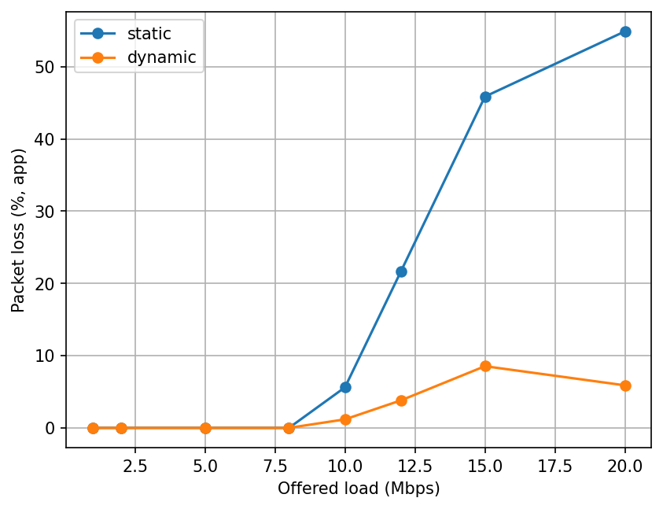
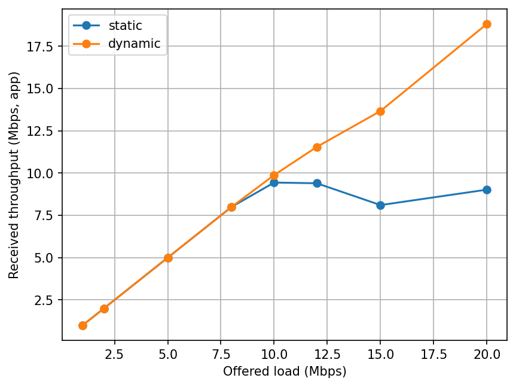
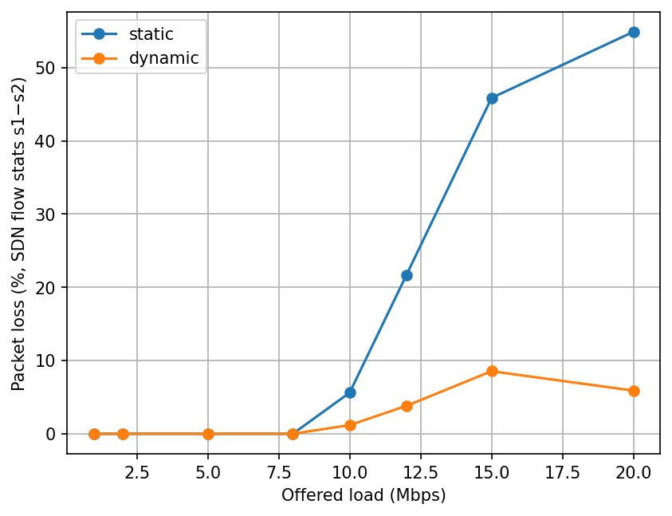
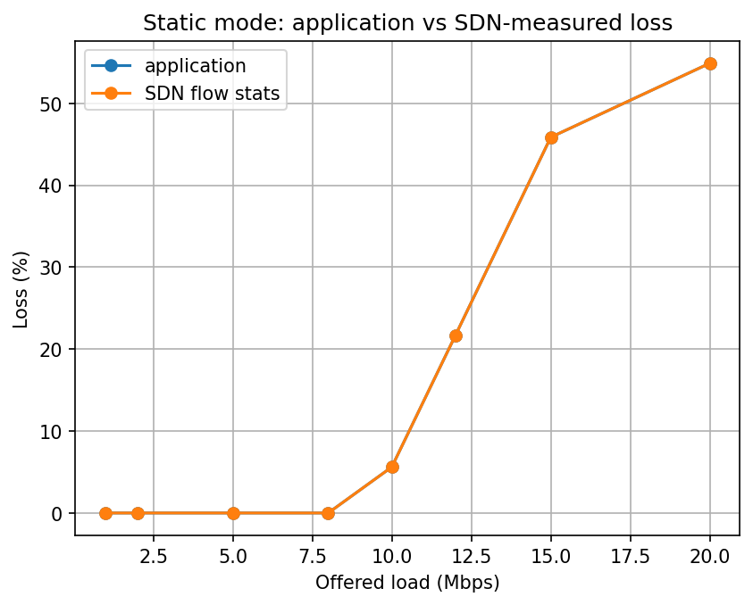
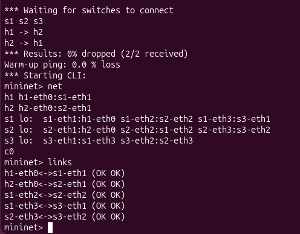
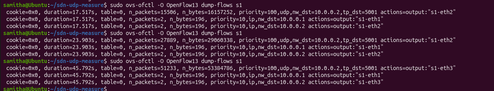
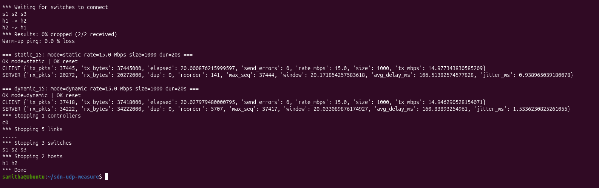
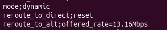
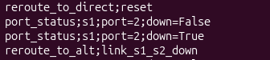

# UDP Traffic Measurement vs SDN Flow Statistics

**Course project:** SDN – Socket Programming (Jackfruit Mini Project)


A UDP-based measurement application (client and server written with low-level
sockets) runs over a Mininet topology controlled by a Ryu OpenFlow 1.3
controller. The project compares what the **application** measures (packets
sent and received, throughput, loss) with what the **SDN switches** count
(flow statistics), under different traffic loads. It also compares a static
controller (baseline) with a dynamic one that reroutes on congestion or link
failure.

## 1. Architecture

```
 h1 (UDP client) ---- s1 ===== 10 Mbps bottleneck ===== s2 ---- h2 (UDP server)
                       \                                 /
                        +------- s3 (100 Mbps alternate path) -------+
                          ^                ^                ^
                          +---- Ryu controller (OpenFlow 1.3) ----+
```

| Component | File | Role |
|---|---|---|
| UDP client | `udp_client.py` | Sends numbered packets at a fixed rate and counts packets and bytes sent |
| UDP server | `udp_server.py` | Counts packets and bytes received, detects loss from sequence numbers, measures delay, jitter and reordering |
| SDN controller | `controller.py` | Installs flows, polls flow stats every 1 s, logs events, reroutes in dynamic mode |
| Topology and runner | `run_experiment.py` | Builds the Mininet topology, runs the load sweep and the link-failure test |
| Analysis | `analyze.py` | Builds `summary.csv` and the graphs |

**Controller details**
- Proactive flows: a generic IP rule (priority 10) and a dedicated measurement
  rule (priority 100) matching `UDP, dst 10.0.0.2, port 5001`. The counters of
  the priority-100 rule are the SDN flow statistics used in the comparison.
- Flow stats are polled every second from s1, s2 and s3 and written to
  `results/flow_stats.csv`. The runner also asks the controller for a snapshot
  before and after each test (`results/snapshots.csv`).
- **Static mode:** never reroutes (baseline).
- **Dynamic mode:** reroutes the flow to the s3 path when (a) the offered rate
  on s1, averaged over a 3 s window, exceeds 9.4 Mbps, or (b) a port-down
  event is seen on the s1-s2 link.
- Rerouting uses `OFPFC_MODIFY_STRICT`, which changes the output port but keeps
  the flow counters, so the comparison stays valid across a reroute.
- The runner steers the controller through a small UDP control port
  (`127.0.0.1:9999`): `MODE`, `RESET`, `SNAPSHOT <label>`.

The 10 Mbps bottleneck is what makes loss happen. A Mininet link without a
bandwidth limit would not drop packets, and there would be nothing to compare.

## 2. Setup

Tested on Ubuntu 26.04 in VirtualBox.

```bash
sudo apt update
sudo apt install -y mininet openvswitch-switch python3-matplotlib git curl
sudo systemctl status openvswitch-switch      # should be active (running)
```

Ryu 4.34 does not install on the system Python (3.14), so the controller runs
in a separate Python 3.9 environment created with `uv`. Mininet and the
experiment scripts keep using the system `python3`. The two sides only talk
over OpenFlow (port 6653) and the UDP control port, so the Python versions do
not need to match.

```bash
curl -LsSf https://astral.sh/uv/install.sh | sh
source ~/.local/bin/env
uv python install 3.9
uv venv --python 3.9 ~/ryu-env
source ~/ryu-env/bin/activate
uv pip install "setuptools<66" wheel pbr
uv pip install --no-build-isolation ryu==4.34 eventlet==0.30.2 "dnspython<2"
ryu-manager --version                         # ryu-manager 4.34
```

## 3. How to run

Use two terminals, both in the project folder.

**Important:** `sudo mn -c` also kills `ryu-manager`, so always run it *before*
starting Ryu, never while Ryu is running.

```bash
# Terminal 2: clean up first
cd ~/sdn-udp-measure
sudo mn -c
```
```bash
# Terminal 1: controller (leave it running)
source ~/ryu-env/bin/activate
cd ~/sdn-udp-measure
ryu-manager controller.py
```
```bash
# Terminal 2: experiments
sudo python3 run_experiment.py                  # full sweep: 1,2,5,8,10,12,15,20 Mbps, static + dynamic
sudo python3 run_experiment.py --failover       # link-failure test
sudo python3 run_experiment.py --cli            # Mininet CLI instead of a test
sudo python3 run_experiment.py --modes dynamic --rates 15 --duration 15   # single custom run

sudo chown -R $USER:$USER results
deactivate                                      # leave ryu-env; matplotlib is on the system Python
python3 analyze.py                              # writes results/summary.csv and the PNG graphs
```

To watch the flow counters live, run this in a third terminal during a test:

```bash
sudo ovs-ofctl -O OpenFlow13 dump-flows s1
```

## 4. Test cases

1. **Normal load:** 1, 2, 5 and 8 Mbps, below the bottleneck.
2. **Congestion:** 10, 12, 15 and 20 Mbps, at or above the bottleneck.
3. **Link failure:** 5 Mbps for 20 s, with the s1-s2 link taken down at t = 8 s.

Each load is run in both static and dynamic mode. UDP payload is 1000 bytes and
each test lasts 20 s.

## 5. Results

### 5.1 Application counters match SDN flow counters exactly

In every run, in both modes:
- application packets sent = packets counted by the flow rule on s1
- application packets received = packets counted by the flow rule on s2
- application loss % = flow-stats loss % ((s1 - s2) / s1)
- `s1_bytes_vs_expected` = 0, so the flow byte counter equals exactly
  packets x (payload + 42 bytes)

Example (5 Mbps, 10 s smoke test): sent 6,250, s1 6,250, received 6,250, s2 6,250.

**Byte and throughput difference:** flow statistics count whole Ethernet
frames, so each 1000 B payload is counted as 1042 B (Ethernet 14 + IP 20 +
UDP 8). SDN-measured throughput is therefore 4.2% higher than the
application-measured throughput (for example 1.042 vs 1.000 Mbps at 1 Mbps
offered).

### 5.2 Static mode (baseline, never reroutes)

| Offered (Mbps) | App TX | s1 count | App RX | s2 count | Loss % | Avg delay (ms) |
|---|---|---|---|---|---|---|
| 1 | 2500 | 2500 | 2500 | 2500 | 0 | 2.62 |
| 2 | 4998 | 4998 | 4998 | 4998 | 0 | 4.79 |
| 5 | 12500 | 12500 | 12500 | 12500 | 0 | 5.54 |
| 8 | 20000 | 20000 | 20000 | 20000 | 0 | 0.67 |
| 10 | 25000 | 25000 | 23597 | 23597 | 5.61 | 82.61 |
| 12 | 30000 | 30000 | 23498 | 23498 | 21.67 | 84.99 |
| 15 | 37501 | 37501 | 23263 | 23263 | 37.97 | 86.16 |
| 20 | 50001 | 50001 | 22553 | 22553 | 54.89 | 93.17 |

- Loss starts at 10 Mbps payload, not above it: 10 Mbps of payload is about
  10.4 Mbps on the wire, which exceeds the 10 Mbps link.
- Received throughput flattens at about 9.0 to 9.8 Mbps (payload) once the
  bottleneck saturates.
- The roughly 85 ms delay under overload matches a full 100-packet queue:
  100 x 1042 B x 8 / 10 Mbps is about 83 ms.

### 5.3 Dynamic mode

| Offered (Mbps) | App TX | s1 count | App RX | s2 count | s3 count | Loss % | Avg delay (ms) |
|---|---|---|---|---|---|---|---|
| 1 | 2500 | 2500 | 2500 | 2500 | 0 | 0 | 1.15 |
| 2 | 5000 | 5000 | 5000 | 5000 | 0 | 0 | 21.73 |
| 5 | 12500 | 12500 | 12500 | 12500 | 0 | 0 | 0.37 |
| 8 | 20000 | 20000 | 20000 | 20000 | 13191 | 0 | 1.03 |
| 10 | 25001 | 25001 | 24706 | 24706 | 20922 | 1.18 | 13.28 |
| 12 | 30001 | 30001 | 28858 | 28858 | 25127 | 3.81 | 11.44 |
| 15 | 37500 | 37500 | 35922 | 35922 | 33133 | 4.21 | 8.55 |
| 20 | 50000 | 50000 | 47053 | 47053 | 44486 | 5.89 | 5.83 |

(s3 count = packets that took the alternate path. The 8 Mbps row is the false
reroute described in the Limitations section.)

### 5.4 Static vs dynamic

| Offered (Mbps) | Static loss % | Dynamic loss % |
|---|---|---|
| 10 | 5.61 | 1.18 |
| 12 | 21.67 | 3.81 |
| 15 | 37.97 | 4.21 |
| 20 | 54.89 | 5.89 |

Dynamic mode cuts loss at 20 Mbps from 54.9% to 5.9% and keeps the delay
low. The remaining dynamic loss comes from packets sent before the reroute
takes effect. Reaction time was not measured directly in the final sweep.






### 5.5 Link failure (5 Mbps, link s1-s2 down at t = 8 s)

| Mode | App TX | App RX | s3 count | Loss % |
|---|---|---|---|---|
| Static | 12500 | 5163 | 0 | 58.7 |
| Dynamic | 12500 | 12488 | 7500 | 0.1 |

- Static: traffic is blackholed after the failure. s1 still counts all 12,500
  packets (it forwards them) while s2 sees only 5,163, so the flow statistics
  show *where* the packets disappeared.
- Dynamic: the controller receives the port-down event and reroutes via s3.
  s3 carried 7,500 packets, which is the 12 s after the failure at 625
  packets/s. Only 12 packets were lost.







## 6. Limitations

- **False reroute at 8 Mbps.** The controller estimates load from flow stats
  polled every second. In this VM the per-second readings swing between 0 and
  about 15 Mbps around a true wire rate of about 8.3 Mbps, so a fixed threshold
  sometimes fires below the bottleneck. Three versions were tried: a
  per-sample check, two consecutive samples, and a 3 s sliding window with a
  threshold of 9.4 Mbps. All three still produced an occasional false
  reroute at 8 Mbps. In the final run it cost no loss (0% at 8 Mbps), only an
  unnecessary path change. The cause of the noisy counter readings was not
  determined.
- **Logged reroute rates at higher loads are lower than the real load** (for
  example 10 to 13 Mbps logged at 15 and 20 Mbps). A likely cause is that the
  3 s window includes idle time before traffic starts; this was not tested.
  Do not read these rates as the offered load.
- **Unexplained early loss.** Early dynamic runs lost a few packets at 1, 2
  and 8 Mbps without any reroute. It did not reproduce in the later sweep, so
  it is treated as run-to-run noise from the VM.
- **Reordering is higher in dynamic mode**, because packets queued on the old
  path arrive after newer packets on the new path. This is the cost of
  rerouting a live flow.
- **Isolated outliers.** The 21.73 ms dynamic delay at 2 Mbps does not fit a
  pattern and is treated as VM noise.
- **Mixed controller versions.** The static and failover rows come from earlier
  runs than the final dynamic rows. The static runs do not use the reroute
  logic, so they are unaffected by the controller changes.
- **Precision limits.** The Python sender paces packets in software, flow
  stats have 1 s granularity, and a single VM runs everything, so small
  differences of a few packets can come from timing alone.
- **Future work:** trigger on bottleneck queue drops or port counters instead
  of an offered-rate threshold, use OpenFlow meters, use a wider threshold
  margin, and test more than one concurrent flow.

## 7. Repository layout

```
sdn-udp-measure/
├── README.md
├── controller.py
├── run_experiment.py
├── udp_client.py
├── udp_server.py
├── analyze.py
├── results/        summary.csv, graphs, raw CSV and JSON outputs
└── docs/           graphs and screenshots
```

## 8. References

- Mininet: https://mininet.org/
- Ryu SDN framework: https://ryu-sdn.org/
- OpenFlow 1.3 specification, Open Networking Foundation
